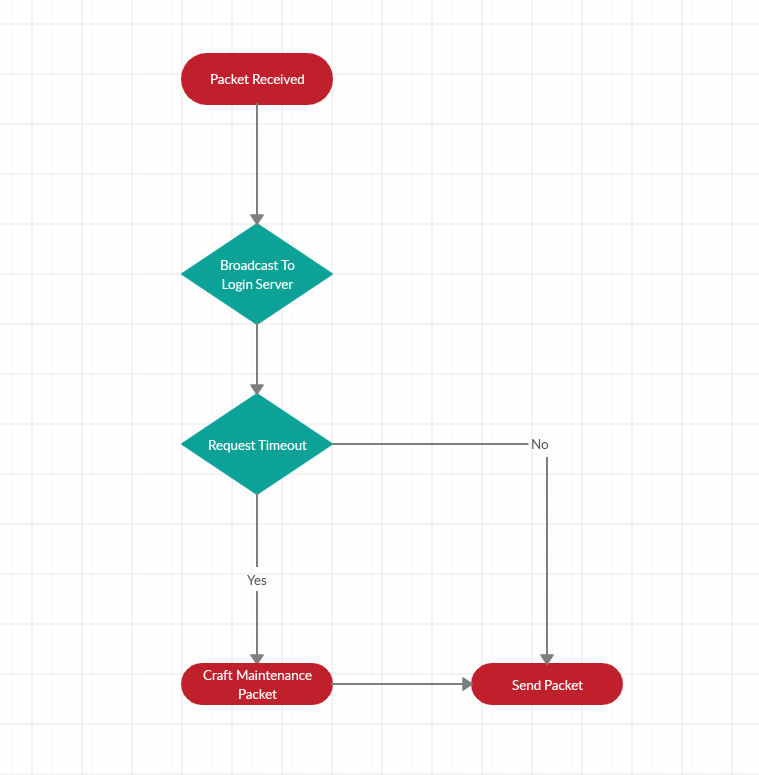

<p align="center">
  
</p>

<h1 align="center">NosCore.ReverseProxy</h1>

<p align="center">
  <a href="https://github.com/NosCoreIO/NosCore.ReverseProxy/actions/workflows/dotnet.yml"></a>
  <a href="https://discord.gg/Eu3ETSw"></a>
  <a href="LICENSE"></a>
</p>

A TCP proxy to put in front of the NosCore login and world servers. Each configured channel listens on a local port
and forwards to a server; when the login server does not answer in time, the proxy replies with the client's own
maintenance message instead of leaving it hanging.

## Configuration

[configuration/reverse-proxy.yml](configuration/reverse-proxy.yml):

```yaml
Timeout: 5000
Language: en
Channels:
  - RemotePort: 4001
    LocalPort: 4000
    RemoteHost: 127.0.0.1
    ServerType: LoginServer
  - RemotePort: 4010
    LocalPort: 1337
    RemoteHost: 127.0.0.1
    ServerType: WorldServer
```

## How it works

<p align="center">
  
</p>

## Running

```bash
dotnet build
dotnet build/net11.0/NosCore.ReverseProxy.dll
```

or `docker compose up`, which mounts `configuration/` into the container.

## Building

```bash
dotnet build
dotnet test
```

## Contributing

Questions, ideas and pull requests are welcome; most of the discussion happens on [Discord](https://discord.gg/Eu3ETSw).
Any editor that handles .NET 11 works: `dotnet build` and `dotnet test` run on Windows, Linux and macOS.
In Visual Studio, [Roslynator](https://github.com/dotnet/roslynator) and
[ReSharper](https://www.jetbrains.com/resharper/) help keep to the code style.

## Supporting NosCore

NosCore is a spare-time open source project. Sponsoring buys time spent on the emulator and the packages around it,
and gives the **Supporter** role on Discord.

<p>
  <a href="https://github.com/sponsors/0Lucifer0"></a>
  <a href="https://ko-fi.com/A3562BQV"></a>
  <a href="https://www.patreon.com/bePatron?u=6503887"></a>
</p>

Thanks to [Navicat](https://www.navicat.com) for supporting the project.

<a href="https://www.navicat.com"></a>

## Legal

NosCore is an independent, unofficial project for educational use. It is not affiliated with, authorized, maintained,
sponsored or endorsed by Gameforge or any of its affiliates; NosTale is a trademark of Gameforge. Using it may be
against the terms of service of NosTale servers.

Released under the [MIT License](LICENSE).
